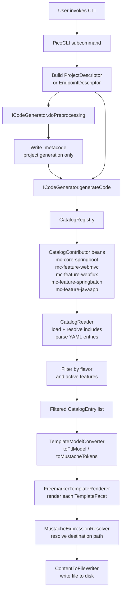

# MetaCode Developer Guide

## Table of Contents

1. [Project Overview](#1-project-overview)
2. [Architecture](#2-architecture)
3. [Key Abstractions](#3-key-abstractions)
4. [Catalog YAML Format](#4-catalog-yaml-format)
5. [Adding a New Feature Module](#5-adding-a-new-feature-module)
6. [CLI Usage](#6-cli-usage)
7. [Testing Strategy](#7-testing-strategy)
8. [Configuration](#8-configuration)

---

## 1. Project Overview

MetaCode is a command-line code generator that scaffolds Spring Boot projects and REST endpoints from declarative YAML catalogs and Freemarker templates. Users invoke the CLI once to create a project skeleton, then invoke it again per resource to add fully-wired REST endpoints, each including controller, service, repository, domain entity, converters, and test fixtures.

### Who Uses It

- Backend developers who want an opinionated, hexagonal- or clean-architecture project without manual wiring.
- Teams standardizing on a consistent package layout across multiple services.
- Anyone who finds the Spring Initializr output too bare and needs pre-wired layers.

### Key Value Proposition

- Catalog-driven generation: templates and their placement on disk are declared in YAML, not hardcoded.
- Architecture-aware: selecting `--architecture hexagonal` (default) or `--architecture clean` changes both the package layout and the naming of ports, adapters, and gateways across every generated file.
- Feature-conditional output: adding `--add postgres,liquibase` activates additional catalog entries that emit Flyway/Liquibase migration stubs, `application.yml` datasource blocks, and Testcontainers base classes — without touching any code path that ignores those features.
- Incremental: `create endpoint` reads the existing `.metacode` written during project generation so it knows the flavor, base package, architecture, and active features without re-asking the user.

---

## 2. Architecture

### Module Breakdown

| Module | Convention Plugin | Role |
|---|---|---|
| `mc-core` | `buildlogic.library-conventions` | Domain model: enums, catalog types, descriptor records, `PackageLayout`, `ArchetypeModel`, `CatalogReader`, `ICodeGenerator`, `CatalogContributor` interfaces |
| `mc-core-springboot` | `buildlogic.library-conventions` | `SpringBootCatalogContributor` and the base catalog YAML (`springboot-base.yaml`) shared by all Spring-based flavors |
| `mc-feature-webmvc` | `buildlogic.library-conventions` | `WebMvcCatalogContributor` and `webmvc.yaml` with WebMVC-specific templates |
| `mc-feature-webflux` | `buildlogic.library-conventions` | `WebFluxCatalogContributor` and `webflux.yaml` with WebFlux-specific templates |
| `mc-feature-springbatch` | `buildlogic.library-conventions` | `SpringBatchCatalogContributor` and `springbatch.yaml` |
| `mc-feature-javaapp` | `buildlogic.library-conventions` | `JavaAppCatalogContributor` and `javaapp.yaml` for plain Java apps (no Spring Boot) |
| `mc-application` | `buildlogic.application-conventions` | Spring Boot entry point, CLI commands, generation engines, Freemarker renderer, file writer |

`mc-application` declares all feature modules as `implementation` dependencies, which causes Spring to pick up every `@Component`-annotated `CatalogContributor` at runtime.

### Code Generation Pipeline



#### Step-by-Step Walkthrough

1. The user runs `metacode create project spring-webmvc -n MyApp -p com.example.myapp --add postgres,openapi`. PicoCLI routes to `SubcommandCreateWebMvcProject`.
2. The subcommand builds a `ProjectDescriptor` with `flavor=WEBMVC`, `features={POSTGRES, OPENAPI}`, and delegates to `CodeGenerationEngine`.
3. `CodeGenerationEngine.doPreprocessing` writes a `.metacode` file into the target directory capturing all choices for later use by `create endpoint`.
4. `CodeGenerationEngine.generateCode` calls `CatalogRegistry.projectEntriesFor(descriptor)`.
5. `CatalogRegistry` iterates all `CatalogContributor` beans, calls `CatalogReader.read` on each catalog resource, and filters the resulting `CatalogEntry` list to entries where `entry.matches(WEBMVC, {POSTGRES, OPENAPI})` returns `true`.
6. For each matching entry, the engine calls `ProjectTemplateModelConverter.toFtlModel` and `toMustacheTokens` to build the two maps needed for rendering.
7. For each `TemplateFacet` in the entry the engine calls `FreemarkerTemplateRenderer.render(sourceTemplate, ftlModel)` to produce a `String`, then `MustacheExpressionResolver.resolve(destination, tokens)` to expand `{{basePackagePath}}` and similar tokens into the actual file path, then `ContentToFileWriter.write` to persist the file.

For endpoint generation, `SubcommandCreateEndpoint` reads `.metacode` to reconstruct context, builds an `EndpointDescriptor`, and delegates to `EndpointCodeGenerationEngine`, which uses `EndpointTemplateModelConverter` and applies the same render/resolve/write loop against endpoint-scoped catalog entries.

---

## 3. Key Abstractions

### 3.1 CatalogEntry, WhenCondition, TemplateFacet

A `CatalogEntry` is one record in a catalog YAML. It has four fields:

| Field | Type | Meaning |
|---|---|---|
| `scope` | `Scope` enum | `PROJECT` — rendered during `create project`; `ENDPOINT` — rendered during `create endpoint` |
| `archetype` | `String` | Logical class name used as the key into the Freemarker model map (e.g. `"Controller"`, `"GlobalExceptionHandler"`) |
| `when` | `WhenCondition` | Optional filter; absent means always render |
| `facets` | `List<TemplateFacet>` | One or more source-template-to-destination pairs |

`WhenCondition` holds two lists:

- `flavor` — the entry renders only when the selected flavor matches one of the listed `Flavor` IDs.
- `features` — the entry renders only when **all** listed features are present in the active feature set.

Both lists may be empty (meaning no restriction). The matching logic is AND: flavor must match AND all features must be present.

```java
// WhenCondition.matches — from source
public boolean matches(Flavor selectedFlavor, Set<Feature> activeFeatures) {
    if (!flavor.isEmpty() && (selectedFlavor == null || !flavor.contains(selectedFlavor))) {
        return false;
    }
    return features.isEmpty() || activeFeatures.containsAll(features);
}
```

A `TemplateFacet` holds:

| Field | Meaning |
|---|---|
| `facet` | Source-set role: `main`, `test`, `integrationTest`, or `testFixtures` |
| `sourceTemplate` | Classpath path to the `.ftl` Freemarker template |
| `destination` | Optional explicit output path with `{{token}}` expressions; derived from `ArchetypeModel` if absent |

### 3.2 ProjectDescriptor and EndpointDescriptor

Both are immutable Lombok `@Value` / `@Builder` records that carry user choices through the pipeline without mutation.

`ProjectDescriptor` fields:

| Field | Type | Default | Description |
|---|---|---|---|
| `applicationName` | `String` | — | Application class name (e.g. `MyApp`) |
| `basePackage` | `String` | — | Root Java package (e.g. `com.example.myapp`) |
| `baseDirectory` | `String` | — | Output directory for generated files |
| `basePath` | `String` | — | Base URL path (e.g. `/petstore`) |
| `flavor` | `Flavor` | — | Framework variant |
| `features` | `Set<Feature>` | empty | Active optional integrations |
| `javaVersion` | `String` | — | Java toolchain version |
| `appModule` | `String` | `"application"` | Sub-module name in generated multi-module build |
| `schema` | `String` | `"public"` | PostgreSQL schema name |
| `architecture` | `Architecture` | `HEXAGONAL` | Package layout variant |

`EndpointDescriptor` carries the same package/flavor/feature/architecture context (read back from `.metacode`) plus:

| Field | Type | Description |
|---|---|---|
| `entityName` | `String` | PascalCase resource name (e.g. `Book`) |
| `route` | `String` | URL base path for this resource (e.g. `/books`) |

### 3.3 ArchetypeModel and PackageLayout

`PackageLayout` reads a YAML file (either `package-layout.yaml` for hexagonal or `clean-arch-package-layout.yaml` for clean architecture) and builds a `Map<String, ArchetypeModel>` keyed by archetype name. Each entry in the layout YAML declares a `subPackage` and a `className`:

```yaml
# excerpt from package-layout.yaml
GlobalExceptionHandler:
  subPackage: infrastructure.advice
  className: GlobalExceptionHandler
```

`PackageLayout.buildArchetypeModels(basePackage)` resolves the full package name by concatenating the base package with the sub-package (e.g. `com.example.myapp.infrastructure.advice`) and returns an `ArchetypeModel` with that package and the class name.

`ArchetypeModel` exposes:

| Method | Returns |
|---|---|
| `packageName()` | Fully qualified package string |
| `className()` | Simple class name |
| `fqcn()` | `packageName + "." + className` |
| `testClass()` | `className + "Test"` |
| `integrationTestClass()` | `className + "IT"` |
| `varName()` | Lowercase-first camelCase version of className |

Freemarker templates use the archetype key to access these values: `${Controller.packageName()}`, `${Controller.className()}`, `${GlobalExceptionHandler.fqcn()}`.

The two package-layout files differ in sub-package naming to reflect the respective architectural convention:

| Archetype | Hexagonal sub-package | Clean sub-package |
|---|---|---|
| `GlobalExceptionHandler` | `infrastructure.advice` | `infrastructure.handlers` |
| `RootController` | `adapter.inbound.web.home` | `interfaces.rest` |
| `AbstractDataStoreApi` | `application.port.outbound` | `application.gateway` |
| `ResourceIdSupplier` | `application.port.outbound` | `application.gateway` |

### 3.4 CodeGenerationEngine and EndpointCodeGenerationEngine

Both engines implement `ICodeGenerator<T>` and are Spring `@Component` beans.

**`CodeGenerationEngine`** handles `ProjectDescriptor`:

- `doPreprocessing` writes `.metacode` to the target directory.
- `generateCode` retrieves only `Scope.PROJECT` entries via `CatalogRegistry.projectEntriesFor`, builds both model maps from `ProjectTemplateModelConverter`, and renders each facet.
- Destination resolution: if a facet carries an explicit `destination`, it is used directly. If not, the engine looks up the archetype name in the Freemarker model map, retrieves the `ArchetypeModel`, and derives the path from the facet's source-set role (`main` → `{{basePackagePath}}/...`, `test` → `{{testBasePackagePath}}/...Class**Test**.java`, etc.).

**`EndpointCodeGenerationEngine`** handles `EndpointDescriptor`:

- `doPreprocessing` is a no-op (properties already exist).
- `generateCode` retrieves only `Scope.ENDPOINT` entries via `CatalogRegistry.endpointEntriesFor`.
- Endpoint catalog entries are required to supply an explicit `destination`; facets with no destination are silently skipped.

**`ContentToFileWriter`** is the production `ContentWriter` implementation; it creates parent directories and writes UTF-8 content. `NoOpContentToFileWriter` (in `testFixtures`) overrides `write` as a no-op and is substituted via `@TestConfiguration` / `@Primary` in integration tests so no files land on disk during CI.

---

## 4. Catalog YAML Format

Each catalog YAML file has two top-level keys: `includes` and `entries`.

### Full Schema

```yaml
includes:
  - /spring/catalogs/springboot-base.yaml   # optional; paths are classpath-absolute

entries:
  - scope: project          # "project" | "endpoint"
    archetype: Controller   # key into the FTL model map
    when:                   # optional; omit to render unconditionally
      flavor:               # optional; list of Flavor ids
        - webmvc
        - webflux
      features:             # optional; ALL must be present
        - postgres
    facets:
      - facet: main         # "main" | "test" | "integrationTest" | "testFixtures"
        sourceTemplate: /spring/templates/webmvc/main/endpoint/Controller.ftl
        destination: "{{basePackagePath}}/adapter/inbound/web/{{lowerCaseEntityName}}/{{entityName}}Controller.java"
      - facet: test
        sourceTemplate: /spring/templates/webmvc/test/endpoint/ControllerTest.ftl
        # destination absent → derived from ArchetypeModel + facet role
```

### Includes

`includes` lists classpath resource paths to other catalogs whose entries are merged in before the current file's entries. `CatalogReader` resolves includes recursively with cycle detection: a resource that has already been visited during the current traversal is skipped with a warning log.

The parsed catalog content is cached in a `ConcurrentHashMap<String, TemplateCatalog>` keyed by resource path so each file is parsed only once per JVM lifetime.

### Scope

| Value | Used by |
|---|---|
| `project` | `CodeGenerationEngine` / `create project` subcommands |
| `endpoint` | `EndpointCodeGenerationEngine` / `create endpoint` subcommand |

### When Conditions

Both sub-lists within `when` are ANDed together. Within each sub-list, membership is checked with OR-semantics (a flavor list of `[webmvc, webflux]` matches either flavor).

An absent `when` block means the entry always matches regardless of flavor or features.

### Destination Token Reference

The following tokens are available in `destination` expressions for project-scope entries:

| Token | Expands to |
|---|---|
| `{{applicationName}}` | Application name passed to `--application-name` |
| `{{basePackage}}` | Base package (dot-separated) |
| `{{basePackagePath}}` | `<appModule>/src/main/java/<base/package/path>` |
| `{{testBasePackagePath}}` | `<appModule>/src/test/java/<base/package/path>` |
| `{{integrationTestBasePackagePath}}` | `<appModule>/src/integrationTest/java/<base/package/path>` |
| `{{testFixturesBasePackagePath}}` | `<appModule>/src/testFixtures/java/<base/package/path>` |
| `{{appModule}}` | Submodule name (default: `application`) |

Additional tokens available in endpoint-scope entries:

| Token | Expands to |
|---|---|
| `{{entityName}}` | PascalCase entity name (e.g. `Book`) |
| `{{lowerCaseEntityName}}` | Lowercase entity name (e.g. `book`) |
| `{{webSegment}}` | Architecture-specific web layer path segment |
| `{{persistSegment}}` | Architecture-specific persistence layer path segment |
| `{{inboundSegment}}` | Architecture-specific inbound port/use-case path segment |
| `{{outboundSegment}}` | Architecture-specific outbound port/gateway path segment |
| `{{domainSegment}}` | Architecture-specific domain path segment |
| `{{dataStoreSuffix}}` | `DataStore` (hexagonal) or `Gateway` (clean) |
| `{{dataStoreImplSuffix}}` | `DataStoreProvider` (hexagonal) or `GatewayProvider` (clean) |
| `{{createTableScriptName}}` | SQL migration script name (e.g. `V0002__create-book-table.sql`) |

### Freemarker Model Variables

Freemarker templates receive both model maps merged together. Key top-level variables:

| Variable | Type | Description |
|---|---|---|
| `applicationName` | `String` | Application name |
| `basePackage` | `String` | Dot-separated base package |
| `basePackagePath` | `String` | Forward-slash base package path (no source root prefix) |
| `flavor` | `String` | Flavor id string (e.g. `"webmvc"`) |
| `architecture` | `String` | Architecture id string (e.g. `"hexagonal"`) |
| `features` | `Set<Feature>` | Active feature enum values |
| `javaVersion` | `String` | Java version string |
| `YEAR` | `int` | Current year |
| `project` | `ProjectModel` | Helper with `isWithPostgres()`, `isWithOpenApi()`, `isWebMvc()`, etc. |
| `endpoint` | `EndpointModel` | (Endpoint templates) helper with entity names, route, `isWithOpenApi()`, `routeConstants` |
| `<ArchetypeName>` | `ArchetypeModel` | One entry per archetype in the layout YAML, e.g. `Controller`, `GlobalExceptionHandler` |

---

## 5. Adding a New Feature Module

This walkthrough adds a hypothetical `mc-feature-graphql` module.

### Step 1: Create the directory and register with Gradle

Create `mc-feature-graphql/` at the project root and add it to `settings.gradle`:

```groovy
include "mc-feature-graphql"
```

### Step 2: Create build.gradle

```groovy
// mc-feature-graphql/build.gradle
plugins {
    id 'buildlogic.library-conventions'
    alias(libs.plugins.lombok.plugin)
}

dependencies {
    implementation project(':mc-core')
    compileOnly libs.spring.context   // CatalogContributor is a Spring @Component

    testImplementation platform(libs.junit.bom)
    testImplementation libs.assertJ
    testImplementation libs.junit.jupiter
    testImplementation libs.mockito
    testRuntimeOnly libs.junit.platform.launcher
}
```

The `buildlogic.library-conventions` plugin wires in Spotless, JaCoCo, Sonar, and the Java 21 toolchain.

### Step 3: Implement CatalogContributor

```java
// mc-feature-graphql/src/main/java/mmm/coffee/metacode/graphql/GraphQlCatalogContributor.java
package mmm.coffee.metacode.graphql;

import mmm.coffee.metacode.core.contributor.CatalogContributor;
import org.springframework.stereotype.Component;

@Component
public class GraphQlCatalogContributor implements CatalogContributor {

    static final String CATALOG_RESOURCE = "/spring/catalogs/graphql.yaml";

    @Override
    public String getCatalogResource() {
        return CATALOG_RESOURCE;
    }
}
```

The `@Component` annotation is essential. `CatalogRegistry` receives all `CatalogContributor` beans by Spring's list injection; if a contributor is not a Spring-managed bean, its catalog entries are never loaded.

### Step 4: Add a Flavor constant

If the new module introduces a new flavor (not a variation of an existing one), add it to `Flavor` in `mc-core`:

```java
// mc-core/.../descriptor/Flavor.java
GRAPHQL("graphql"),
```

If the new module only adds feature-gated entries that work alongside an existing flavor (e.g. graphql support inside a webmvc project), no new `Flavor` constant is needed — use `features:` conditions in the catalog YAML instead.

### Step 5: Create the catalog YAML

Create `mc-feature-graphql/src/main/resources/spring/catalogs/graphql.yaml`. All entries must carry a `when: flavor:` guard so they do not accidentally render for unrelated flavors.

```yaml
# mc-feature-graphql/src/main/resources/spring/catalogs/graphql.yaml

entries:

  - scope: project
    archetype: GraphQlConfiguration
    when:
      flavor: [graphql]
    facets:
      - facet: main
        sourceTemplate: /spring/templates/graphql/main/config/GraphQlConfiguration.ftl
        destination: "{{basePackagePath}}/infrastructure/config/GraphQlConfiguration.java"
      - facet: test
        sourceTemplate: /spring/templates/graphql/test/config/GraphQlConfigurationTest.ftl
        destination: "{{testBasePackagePath}}/infrastructure/config/GraphQlConfigurationTest.java"

  - scope: endpoint
    archetype: Controller
    when:
      flavor: [graphql]
    facets:
      - facet: main
        sourceTemplate: /spring/templates/graphql/main/endpoint/GraphQlController.ftl
        destination: "{{basePackagePath}}/{{webSegment}}/{{lowerCaseEntityName}}/{{entityName}}Controller.java"
```

If the catalog is large, split it into sub-catalogs and compose them with `includes:`.

### Step 6: Add Freemarker templates

Create `.ftl` templates under `src/main/resources/spring/templates/graphql/`. The template path in `sourceTemplate` must match the classpath location exactly.

Templates receive all variables described in the [Freemarker Model Variables](#freemarker-model-variables) table. Access archetype information with `${ArchetypeName.packageName()}`, `${ArchetypeName.className()}`, etc. Access feature flags with `${project.isWithPostgres()}` or `<#if project.isWithOpenApi()>`.

### Step 7: Register as a dependency in mc-application

```groovy
// mc-application/build.gradle
dependencies {
    // ... existing entries ...
    implementation project(':mc-feature-graphql')
}
```

Without this entry, the `GraphQlCatalogContributor` class will not be on the classpath at runtime and Spring will not discover it.

### Step 8: Add a CLI subcommand (if introducing a new flavor)

If you added a new `Flavor` constant, create a subcommand in `mc-application`:

```java
// mc-application/.../cli/SubcommandCreateGraphQlProject.java
@Component
@CommandLine.Command(
        name = "graphql",
        description = "Generate a Spring GraphQL project",
        mixinStandardHelpOptions = true)
public class SubcommandCreateGraphQlProject extends AbstractCreateProject {

    private final ICodeGenerator<ProjectDescriptor> codeGenerator;

    public SubcommandCreateGraphQlProject(ICodeGenerator<ProjectDescriptor> codeGenerator) {
        this.codeGenerator = codeGenerator;
    }

    @Override
    public void run() {
        ProjectDescriptor descriptor = ProjectDescriptor.builder()
                .applicationName(applicationName)
                .basePackage(basePackage)
                .baseDirectory(baseDirectory)
                .basePath(basePath)
                .flavor(Flavor.GRAPHQL)
                .features(activeFeatures())
                .javaVersion(javaVersion)
                .schema(schema)
                .architecture(selectedArchitecture())
                .build();

        codeGenerator.doPreprocessing(descriptor).generateCode(descriptor);
    }
}
```

Then register it in `SubcommandCreateProject`:

```java
@CommandLine.Command(
    name = "project",
    subcommands = {
        SubcommandCreateWebMvcProject.class,
        SubcommandCreateWebFluxProject.class,
        SubcommandCreateSpringBootProject.class,
        SubcommandCreateSpringBatchProject.class,
        SubcommandCreateJavaAppProject.class,
        SubcommandCreateGraphQlProject.class,   // add this
        CommandLine.HelpCommand.class
    }, ...)
```

### Step 9: Write tests

Unit-test the contributor to guard the catalog resource path:

```java
class GraphQlCatalogContributorTest {
    @Test
    void catalogResourceExists() {
        String resource = new GraphQlCatalogContributor().getCatalogResource();
        assertThat(GraphQlCatalogContributor.class.getResourceAsStream(resource)).isNotNull();
    }
}
```

Add an integration test in `mc-application` following the pattern of `CreateSpringWebMvcProjectIT`. Use `@TestConfiguration` with a `@Primary` `NoOpContentToFileWriter` bean so no files are written during the test run.

---

## 6. CLI Usage

### Command Hierarchy

```
metacode
└── create
    ├── project
    │   ├── spring-webmvc
    │   ├── spring-webflux
    │   ├── spring-boot
    │   ├── spring-batch
    │   └── java-app
    └── endpoint
```

### Project Subcommands

All project subcommands extend `AbstractCreateProject` and share the same set of options.

#### Common Options

| Option | Short | Required | Default | Description |
|---|---|---|---|---|
| `--package` | `-p` | Yes | — | Base package name (e.g. `com.example.demo`) |
| `--application-name` | `-n` | Yes | — | Application class name (e.g. `DemoApplication`) |
| `--directory` | `-d` | No | `.` | Output directory |
| `--route` / `--base-path` | `-r` | No | `/` | Base URL path for the application |
| `--schema` | — | No | `public` | PostgreSQL schema name |
| `--add` | — | No | — | Comma-separated or space-separated list of features |
| `--java` | — | No | `21` | Java toolchain version |
| `--architecture` | — | No | `hexagonal` | Package layout: `hexagonal` or `clean` |

#### Feature Values (`--add`)

| Value | Activates |
|---|---|
| `postgres` | PostgreSQL datasource configuration, JPA setup |
| `testcontainers` | Testcontainers base classes for integration tests |
| `liquibase` | Liquibase migration configuration and changelog stubs |
| `flyway` | Flyway migration configuration and SQL script stubs |
| `openapi` | SpringDoc OpenAPI/Swagger configuration |
| `mongodb` | MongoDB datasource configuration |
| `kafka` | Kafka producer/consumer configuration |

`liquibase` and `flyway` are mutually exclusive. Specifying both produces a parameter error before any files are written.

#### Examples

```bash
# Minimal WebMVC project
metacode create project spring-webmvc \
  --application-name PetstoreApp \
  --package com.example.petstore

# WebFlux project with Postgres, Liquibase, OpenAPI, and clean architecture
metacode create project spring-webflux \
  --application-name InventoryService \
  --package com.example.inventory \
  --directory /workspace/inventory-service \
  --route /inventory \
  --add postgres,liquibase,openapi,testcontainers \
  --architecture clean

# Plain Spring Boot project (no web framework)
metacode create project spring-boot \
  --application-name SchedulerApp \
  --package com.example.scheduler \
  --directory ./scheduler-app \
  --java 21

# Spring Batch project
metacode create project spring-batch \
  --application-name ReportBatchJob \
  --package com.example.batch \
  --directory ./batch-job \
  --add postgres

# Plain Java app (no Spring)
metacode create project java-app \
  --application-name UtilityLib \
  --package com.example.utility \
  --directory ./utility-lib
```

### Endpoint Subcommand

```
metacode create endpoint [OPTIONS]
```

| Option | Short | Required | Default | Description |
|---|---|---|---|---|
| `--resource` | `-e` | Yes | — | PascalCase resource/entity name (e.g. `Book`) |
| `--route` | `-r` | Yes | — | Base URL for this resource (e.g. `/books`) |
| `--directory` | `-d` | No | `.` | Project root directory containing `.metacode` |

The endpoint subcommand reads `.metacode` from the project directory to recover the flavor, base package, app module, java version, active features, and architecture. All these values were written during `create project`. If `.metacode` is absent, the command fails with an informative error.

The `resource` value is capitalized automatically, so `--resource book` and `--resource Book` both produce a `Book` entity.

#### Examples

```bash
# Generate a Book endpoint in the current directory
metacode create endpoint --resource Book --route /books

# Generate in a specific directory
metacode create endpoint \
  --resource PetOwner \
  --route /pet-owners \
  --directory /workspace/petstore-app

# Short flags
metacode create endpoint -e Order -r /orders -d ./my-project
```

---

## 7. Testing Strategy

### Test Layout

Each module follows the same directory structure:

```
<module>/
├── src/
│   ├── main/java/            # Production code
│   ├── test/java/            # Unit tests (JUnit 5 + Mockito)
│   └── integrationTest/java/ # Integration tests (mc-application only)
└── build.gradle
```

The `integrationTest` source set is declared by the `buildlogic.integration-test` convention plugin and is included in the `check` lifecycle task. Only `mc-application` has integration tests; feature modules use unit tests only.

`mc-application` also has a `testFixtures` source set that publishes `NoOpContentToFileWriter` as a shared test helper. The `integrationTest` suite depends on `testFixtures(project())`.

### Unit Tests

Located in `src/test/java`. Run with `./gradlew test` or per module with `./gradlew :mc-core:test`.

Key unit test classes:

| Class | Module | What it covers |
|---|---|---|
| `CatalogReaderTest` | `mc-core` | YAML loading, includes resolution, cycle detection |
| `WhenConditionTest` | `mc-core` | Matching logic for flavor and feature combinations |
| `ArchitectureTest` | `mc-core` | `fromId` parsing and `layoutResource` values |
| `FeatureTest` / `FlavorTest` | `mc-core` | Enum `fromId` parsing |
| `CatalogRegistryTest` | `mc-application` | Entry filtering by flavor and scope |
| `ProjectTemplateModelConverterTest` | `mc-application` | FTL model and Mustache token map contents |
| `EndpointTemplateModelConverterTest` | `mc-application` | Endpoint model for hexagonal and clean arch |
| `CodeGenerationEngineTest` | `mc-application` | Engine calls renderer and writer for each facet |
| `MustacheExpressionResolverTest` | `mc-application` | Token substitution in destination paths |
| `FreemarkerTemplateRendererTest` | `mc-application` | Template rendering against fixture `.ftl` files |
| `SubcommandCreate*Test` | `mc-application` | CLI flag parsing and descriptor construction |

CLI tests (`SubcommandCreate*Test`) use `CommandLine` directly (no Spring context) to verify that flags are parsed correctly and illegal combinations (e.g. `liquibase + flyway`) throw the expected exception.

### Integration Tests

Located in `mc-application/src/integrationTest/java`. Run with `./gradlew integrationTest`.

Each `Create*IT` class boots the full Spring context with `@SpringBootTest(args = {})` and uses a `@TestConfiguration` to replace the production `ContentToFileWriter` with the `NoOpContentToFileWriter`. This exercises the entire pipeline — catalog loading, Freemarker rendering, Mustache resolution — without writing any files to disk. The test asserts only that the CLI exit code is zero.

`AbstractIntegrationTest` activates Spring profiles `test` and `integrationTest` and is the base class for simple full-context tests that do not need a Postgres container.

The `ApplicationIntegrationTest` class verifies the Spring context loads cleanly.

### Running Tests

```bash
# All tests (unit + integration) in all modules
./gradlew build

# Unit tests only across all modules
./gradlew test

# Integration tests only
./gradlew integrationTest

# Single module unit tests
./gradlew :mc-core:test
./gradlew :mc-application:test

# Single test class
./gradlew :mc-core:test --tests "mmm.coffee.metacode.core.catalog.CatalogReaderTest"

# Check code formatting (does not modify files)
./gradlew spotlessCheck

# Apply code formatting
./gradlew spotlessApply
```

Formatting is enforced via Spotless with the Palantir Java Format style. `spotlessApply` runs automatically as part of `build` and `check`; a formatting violation breaks the build.

---

## 8. Configuration

### application.yml

Located at `mc-application/src/main/resources/application.yml`. MetaCode runs as a non-web Spring Boot application:

```yaml
spring:
  application:
    name: metacode
  main:
    web-application-type: none
    banner-mode: off

logging:
  level:
    root: ERROR
    org.springframework: ERROR
    mmm.coffee: WARN
  pattern:
    console: "%logger{36} - %msg%n"
    file: "%logger{36} - %msg%n"
```

No datasource, server port, or actuator configuration is present. The application starts, runs the CLI command, and exits.

### .metacode

This file is **generated** by MetaCode during `create project`; it is not an input configuration file. It is written to the target directory and must not be edited manually. It records the choices made at project-creation time so the `create endpoint` command can reconstruct context without asking the user again.

Generated content (example):

```properties
# Generated by MetaCode — do not edit manually
framework=webmvc
basePackage=com.example.petstore
basePath=/petstore
appModule=application
javaVersion=21
features=postgres,openapi
architecture=hexagonal
```

Properties written:

| Key | Source |
|---|---|
| `framework` | `Flavor.id()` (e.g. `webmvc`) |
| `basePackage` | `--package` option |
| `basePath` | `--route` option |
| `appModule` | `--app-module` option (default: `application`) |
| `javaVersion` | `--java` option (default: `21`) |
| `features` | Comma-joined `Feature.id()` values from `--add` |
| `architecture` | `Architecture.id()` (default: `hexagonal`) |

### Package Layout YAMLs

Two package-layout files ship in `mc-core/src/main/resources/`:

| File | Architecture | Loaded by |
|---|---|---|
| `package-layout.yaml` | `Architecture.HEXAGONAL` | `PackageLayout.load("/package-layout.yaml")` |
| `clean-arch-package-layout.yaml` | `Architecture.CLEAN` | `PackageLayout.load("/clean-arch-package-layout.yaml")` |

Both files have the same YAML structure:

```yaml
archetypes:
  <ArchetypeName>:
    subPackage: <sub-package relative to basePackage, may be empty>
    className: <simple class name>
```

Each archetype entry becomes a key in the Freemarker model map. Adding a new archetype key here makes it available to all templates; removing one will cause a `NullPointerException` in any template that references it.

### Catalog YAML Locations

Each feature module ships its catalog under `src/main/resources/spring/catalogs/`:

| Module | Catalog path |
|---|---|
| `mc-core-springboot` | `/spring/catalogs/springboot-base.yaml` |
| `mc-feature-webmvc` | `/spring/catalogs/webmvc.yaml` |
| `mc-feature-webflux` | `/spring/catalogs/webflux.yaml` |
| `mc-feature-springbatch` | `/spring/catalogs/springbatch.yaml` |
| `mc-feature-javaapp` | `/spring/catalogs/javaapp.yaml` |

Freemarker templates live under `src/main/resources/spring/templates/<flavor>/`.

### AppConfiguration (Spring Beans)

`AppConfiguration` in `mc-application` declares two beans that are not Spring Boot auto-configured:

```java
@Configuration
public class AppConfiguration {

    @Bean
    CatalogReader catalogReader() {
        return new CatalogReader();
    }

    @Bean
    TemplateRenderer templateRenderer() {
        return new FreemarkerTemplateRenderer();
    }
}
```

`FreemarkerTemplateRenderer` loads templates from the classpath root using `FreemarkerTemplateRenderer.class.getClassLoader()` as the template loader, which makes classpath-absolute template paths like `/spring/templates/webmvc/main/config/WebMvcConfiguration.ftl` work correctly.

### Build System

MetaCode uses a Gradle multi-project build with convention plugins in `gradle/plugins/java-conventions/`.

| Convention plugin | Applied to | Provides |
|---|---|---|
| `buildlogic.java-conventions` | All modules (via other plugins) | Java 21 toolchain, Spotless, JaCoCo, Sonar |
| `buildlogic.library-conventions` | Feature and core modules | `java-library` plugin + `java-conventions` |
| `buildlogic.application-conventions` | `mc-application` | Spring Boot plugin, Jib, `java-conventions` |
| `buildlogic.integration-test` | `mc-application` | `integrationTest` JVM test suite wired into `check` |

The Java version is read from `.java-version` at the project root (currently `21`).

#### Additional Build Tasks

```bash
# Build Docker image (requires Docker daemon)
./gradlew jibDockerBuild

# Check for dependency version updates
./gradlew dependencyUpdates

# Build with SonarQube analysis (requires sonar config in gradle.properties)
./gradlew clean build sonar

# Stage the application jar for end-to-end testing
./gradlew :mc-application:stage
```
